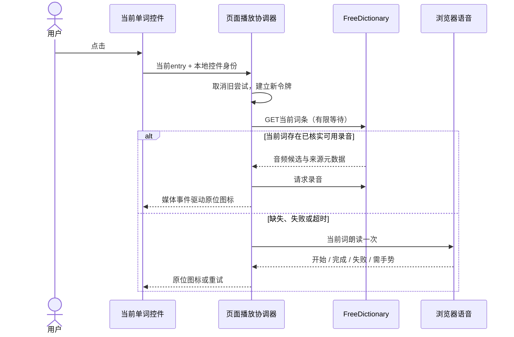

# 单词发音：后端边界与外部调用方案

建议沿原方案使用 **FreeDictionary 音频优先 → 浏览器 speechSynthesis 兜底**，由客户端完成请求和播放协调。首版不增加项目后端发音接口、音频代理、常驻连接、数据库或队列。已有学习数据读取和造文服务保持原职责。

这是架构审阅稿。真实浏览器播放尚未验证成功，音源使用说明的落实仍在 OPEN-401；不能将本稿当成已具备上线条件的发音交付。

## 1. 有效输入与本轮纠正

- [产品08](../../product/pronunciation/overview.md)、[已接受UI32-R3](../../handoffs/pronunciation-uiux-accepted.md)、[DB-PRON-01](database.md)及[接收门禁134](../../reviews/pronunciation-backend-entry-134.md)为基线。
- 用户本轮指出“最初设计不是只招 freedictionary 和兜底免费的 google 控件？”；[原始记录](../../../M002-legacy-M004/reviews/evidence/start/authorization.json)明确兜底为浏览器 `speechSynthesis`。[本轮确认记录](evidence/backend/scope-clarification.json)保留原话和解释，不把 Google Cloud TTS、Google Translate 非公开接口或新音源加入范围。
- 页面仍仅 PAGE-402 计划/结果词义卡、PAGE-403 已保存文章接入；无选词播放。裸图标、无可见操作/状态文字、单音源隐藏来源文字等沿 R3。**此前提出的页底“音频来源”入口未获采用，已撤回，不进入本方案或实现任务。**
- FreeDictionary 返回的 `sourceUrl` 是录音来源元数据，不是要接入的第三个音源。首版运行链路不查询 Wikimedia API，也不抓取来源页面；研究时核对来源不等于增加产品集成。
- “Google 控件”在本稿按原记录理解为浏览器提供的语音能力；实际声音来自 `getVoices()`，不承诺每台设备有 Google 声音，不要求用户配置 Google Key。[MDN声音列表说明](https://developer.mozilla.org/en-US/docs/Web/API/SpeechSynthesis/getVoices)

## 2. 现状与实测

只读源码及其版本见[输入哈希](evidence/backend/input-manifest.json)。

| 证据 | 事实与含义 |
| --- | --- |
| `backend/internal/httpapi/server.go` 的 `/api/v1` 路由组；`middleware.go` 的 `resolveActor` | 现有业务 API 会解析会话/访客身份。没有必要让公共单词发音进入这条链路，也不能以“新增GET无写入”忽略身份处理中可能发生的数据操作 |
| `frontend/app/infrastructure/http/transports/transport.ts` | 现有服务端 transport 可转发 cookie；外部词典调用应使用独立的客户端适配器，不能复用该服务端转发器 |
| `GenerationContent.vue`、`GenerationVocabularyList.vue`、`library/[batchId].vue` | `entry` 已在当前卡片中；不再请求私人文章、不重新查询词库；不发送释义、用法或正文 |
| `frontend/nuxt.config.ts`、`backend/internal/httpapi/middleware.go` | 前端配置目前仅显式设置缓存响应头；Go安全头中的CSP作用于其响应，不等于已证明页面最终CSP。部署验收须检查HTML实际响应与网关，不擅自关闭现有安全策略 |
| 词库静态读取 | 当前资产13,860项，最长18字符，含 `according to`、连字符等现有条目；不能用“仅a-z”校验误拒既有目标词。这不扩展为用户任意输入整篇TTS |

真实探测均保持TLS验证，无登录、无Key、无mock，无生产代码改动：

| 观察 | 结果 | 可得结论 / 限制 |
| --- | --- | --- |
| [命令行词条探测](evidence/backend/network-probe.json) | `hello` HTTP200，约1.077秒；响应头含 `Access-Control-Allow-Origin: *`。`gentle` 和缺词样例均在12秒超时 | 至少一次真实词条可取得；没有证明缺词404行为、稳定延迟或目标用户区域可用性 |
| [录音与补充词探测](evidence/backend/network-audio-probe.json) | `hello-uk.mp3`、`museum` 请求均在10秒超时 | 尚无音频下载成功证据；不能推断音源全球失效 |
| [独立浏览器探测](evidence/backend/browser-probe.json) | Chromium 151.0.7922.34：词条5秒超时；录音10秒内无媒体就绪/播放事件；设备声音数0 | 浏览器真实播放未通过。命令行成功不替代浏览器证据；无头环境声音数0不代表用户电脑没有声音 |

探测脚本只启动临时回环页面并在结束时关闭，不访问UAT或修改其模型配置。未进行人工听音。OPEN-402/403继续开放，不以接口返回200或静态图标演示抵充。

## 3. 架构取舍与职责

| 路径 | 收益 | 代价 | 本稿建议 |
| --- | --- | --- | --- |
| 浏览器直连FreeDictionary，浏览器兜底 | 没有项目服务端按播放次数增长的代理连接/流量；不需要密钥、会话、DB或新服务 | 用户网络、CORS、浏览器能力影响成功率；请求会到第三方 | 首版采用，真实环境验证仍是交付条件 |
| 后端查词或代理音频 | 可集中处理上游策略；在特定网络拓扑下可能有收益 | 增加请求占用、带宽、滥用防护和维护；也无法自动修复客户端播放限制 | 当前无证据表明代理能解决此次超时，不实施。以后有明确网络或密钥需求再评估 |

“可用录音”同时要求请求/内容有效、目标匹配、资源安全及OPEN-401使用条件落实；本轮不把未落实使用条件的录音自动视为可上线资源。媒体加载失败也进入同一次浏览器兜底。具体合同见[API-401/402](api/index.md)。

| 模块 | 责任与交接 |
| --- | --- |
| Go服务、Nuxt服务端 | 本增量不新增运行模块、发音路由或发音代理；已有文章权限、造文、保存、额度各自运行 |
| 客户端FreeDictionary适配器 | 只传当前entry；固定域名、响应筛选、请求期限和取消；返回音频候选或有限错误，保留资源级元数据 |
| 页面播放协调器 | 每页一个活动意图，尝试令牌隔离；媒体/语音二选一、有限回退、生命周期释放；由frontend-bob完成具体状态机及代码分层 |
| 当前单词控件 | 只消费本词的状态，不承载服务调用、全局状态通知或播放队列；沿R3还原 |
| 浏览器语音适配器 | 发现实际英语声音，处理就绪、用户手势、开始/结束/错误和取消；设备对象只存在客户端 |

## 4. 请求、失败与并发边界

BE401-R1：只在主动点击时查词；不在SSR、页面加载或每张卡片出现时批量预取。原词条作为固定输入，外部参数仅作安全编码，不回写卡片。不得请求整篇文章或把例句当输入。

BE401-R2：每个新尝试至多一次词条请求、一次选定录音尝试和一次浏览器回退；不遍历所有录音碰运气，不后台自动重试。手动重试建立新尝试；如果只是浏览器要求再次手势，则直接尝试已进入的语音路径。收到429结束本次词典请求，不排队等待上游。

BE401-R3：建议词条等待上限 **2.5秒**（含读取/解析响应），录音开始等待上限 **2.5秒**。因此冷启动词典路径最多占用约5秒后进入兜底，不沿探测脚本的10～12秒等待。数值是待审技术预算，依据单词操作应快速收敛，尚无成功率统计；不是供应商SLA。浏览器声音就绪、朗读启动和播放结束看门狗由OPEN-403给出明确界限，不能把“已调用speak”当作开始播放。后台挂起可能延迟定时器，恢复时先检查截止时间与令牌。

BE401-R4：切词/口音、同词重播或目标移除，先使旧令牌失效，再abort词条请求、停止媒体、取消语音并解除监听。媒体停止后需释放src/句柄；所有异步事件检查页面代次和令牌。即使网络取消未及时完成，也不得晚到抢播。用户取消不自动触发兜底。并发边界来自已接受DB401-C1～C5。

BE401-R5：可以复用当前可见卡片本次取得的候选，避免同词立即重播又查词；卡片/页面/会话失效或该资源失败即丢弃。只保留当前页面范围，不建跨页面缓存、持久失败记录、Service Worker音频库或服务器缓存。浏览器自身HTTP缓存仍由浏览器/响应头控制，不承诺绝无缓存。

BE401-R6：菜单只列真实可选资源；词典路径和兜底路径不自动算两个选择项。FreeDictionary当前样本没有结构化口音字段，**不单凭文件名后缀或IPA认定英美口音**；没有可验证地区标识就保持未知。浏览器声音的语言标签可用于地区选择；已选口音不可用时只尝试同口音，其他声音须经用户显式选择。最终菜单映射交前端设计，禁止虚构双口音。

## 5. 音源使用条件：保留原问题，不扩展产品

[FreeDictionary官方](https://dictionaryapi.dev/)提供公共词条接口；[维护者迁移说明](https://github.com/meetDeveloper/freeDictionaryAPI/issues/102)说明词条来源调整。接口免费、开源仓库许可与具体录音的使用条件是不同信息。

本次 `hello` 实际返回两个非空录音：一个资源级许可为BY-SA 4.0，一个为BY 3.0 US；另一个音标项音频为空。资源级许可与词条顶层的CC BY-SA 3.0不能混用，原数据见[hello响应](evidence/backend/hello.json)。相关许可包含署名条件，见[BY 3.0 US原文](https://creativecommons.org/licenses/by/3.0/us/legalcode.en)与[BY-SA 4.0说明](https://creativecommons.org/licenses/by-sa/4.0/)。

**OPEN-401当前状态：资料核实有进展，落实未完成。** 不据此更换音源、接入Wikimedia、添加页脚/弹窗，亦不假定隐藏在aria、仅保存URL或后端转发便自动满足使用条件。用户本轮纠正音源范围没有选择前次署名选项，也没有豁免上游使用条件。

后续仍由backend-alex在原OPEN-401内核实FreeDictionary具体资源说明的可行落实方式；如最终必须改变已批准UI，再提交明确、局部的产品/设计差异。此时不把前次撤回建议重新作为默认方案，不新增CR来预定新入口。该项未解决前，不能宣布词典录音可上线；也不能静默把首版变为仅浏览器朗读并声称符合双路径需求。

## 6. 权限、安全与部署

- 客户端外部fetch使用 `credentials: omit`、`referrerPolicy: no-referrer`、不携带应用自定义认证头，固定HTTPS域名；不使用现有SSR转发器。媒体请求使用匿名CORS；为避免携带页面路径，建议用独立fetch取得有限音频Blob后本地播放，音频原域仍必须允许CORS。其额外内存与对象URL释放由前端接收；若直接使用媒体src，必须先证明不泄露敏感referer/凭据。二者不能未经验证随意切换。
- 不接受用户指定任意URL。首版音频允许 `https://api.dictionaryapi.dev/media/pronunciations/en/` 下实际返回的音频，拒绝HTTP、data、javascript、用户信息、非标准端口、站外跳转及陌生域名；不追踪来源链接取内容。上游若迁移到其他域名，按已知失败兜底，先验证后再改名单。
- 元数据按数据读取，不执行HTML/脚本。录音、来源和许可URL均不直接作为任意DOM HTML。敏感正文、账号、访客ID、文章ID、造文令牌不离开应用；用户IP等网络元信息仍由请求路径产生。
- 权益无需额外鉴权；页面本身继续遵守文章所有者检查。额度耗尽不禁发音，声音失败不清空生成流、不影响保存或计费。没有新增写接口，因此没有发音CSRF、幂等键、事务或清理作业。
- 不新增Docker服务、端口、凭据、环境变量、运维配置分类或数据库迁移。客户端模块按原前端构建发布；不修改真实UAT。若HTML网关设CSP，最低需允许FreeDictionary的 `connect-src`，采用Blob播放时需 `media-src blob:`；沿已有策略做最小合并，禁止用通配符/关闭策略修复。浏览器语音可用性还受设备设置影响。
- 回退发布使用前一个前端构建；无DB回滚。部署前必须先完成开放项与功能验证，本次文档不授权发布。

## 7. 容量、费用与最小观测

直连方案下，**一次播放不新增本项目后端请求、音频出站流量或DB操作**；现有网页下载和第三方/终端资源成本仍存在。没有用实测支持的“无限并发”结论。供应商限流、用户网络与设备能力是该路径的主要限制。

保留估算方法，避免凭感觉引入代理：若以后代理，每秒播放尝试为r，需新查词比例p，词条平均耗时L秒，则平均上游并发约为 `r × p × L`；若代理音频，每次B字节、成功取音频比例q，音频出站约为 `r × q × B` 字节/秒。例：r=10、p=1、L=2时约20个查词等待；B=50KiB、q=1时约0.49MiB/秒音频出站。它们是场景算例，不是本项目当前负载、实际录音大小或账单报价。

首版不扩建分析后台。实施验证可用浏览器Network/Performance及测试记录采集词条耗时、音频耗时、fallback原因、start/end事件与取消是否生效；只记去内容的分类与时长，不上传逐词播放历史。本轮原有Go指标不统计直连播放，不能用服务端指标缺失证明零失败。后续若需要业务统计另按需求决定。

## 8. 验证与下游接收

| ID / 追踪 | 完成条件 | 本轮状态 |
| --- | --- | --- |
| BE401-V1 / API-401，AC-401/408/409 | 真实当前词参数、现有含空格/连字符条目、空响应/错误结构、URL与大小边界；禁止发送整篇/身份 | 合同已给出，实现未验证 |
| BE401-V2 / CAP-402/404，AC-403/405/406 | 成功只走一条声音；错误/超时只回退一次；取消不回退；词条2.5秒界限、迟到事件、重试/再手势分类 | 合同已给出，端到端未验证 |
| BE401-V3 / DATA-402/403，AC-404/410 | 真实资源/口音、来源事实与使用条件；不以文件名制造地区、不将浏览器声音标成真人录音 | OPEN-401/403 |
| BE401-V4 / CAP-401/404，AC-407/409 | 游客/普通/付费均可尝试，额度为0仍可；没有新增后端发音请求/持久记录/额度变化 | 方案满足边界，产品实现未验证 |
| BE401-V5 / OPEN-402，AC-410 | 用户实际环境的词条→音频→playing/ended及必要人工听音，补缺词/单音源；验证最终CSP与CORS | 当前环境探测未通过，保留原失败记录 |
| BE401-V6 / OPEN-403，AC-402/405/406 | 指定浏览器/设备的英语声音、延后就绪、手势限制、开始/结束界限、取消；R3无布局跳动 | frontend-bob接收，当前无头环境0声音不算通过 |

确定性替身用于失败/竞态合同，真实来源/播放检查必须独立保留；QA不做文章质量测试，不为发音制造真实模型调用。下一角色的具体任务见[后端交接](../../handoffs/pronunciation-backend-architecture.md)。本稿未关闭OPEN-401～403，也未跨阶段。
