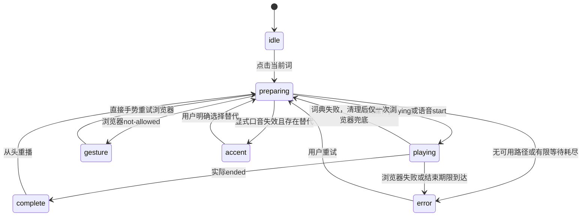

# 单词发音前端技术方案

复用当前 Nuxt/Vue 工程，在工具台计划/结果词义和已保存文章学习卡中接入同一个裸图标控件；由浏览器中的单一协调器完成 FreeDictionary 请求、音频播放与 speechSynthesis 兜底。业务后端、生成流、额度与保存合同不增加发音字段。

本稿为技术设计，未编写产品实现。前端状态与接入方案已明确；[CR-315](../../changes/CR-315.md) 的口音替代设计缺口、OPEN-401 使用条件和 OPEN-402/403 真机验证尚未闭环，不能据此宣布完整技术出口或语音交付可用。

## 1. 接收基线与确认

- CONFIRMED：产品 [CAP-401～404、AC-401～410](../../product/pronunciation/abilities.md)、[DATA-401～404](../../product/pronunciation/data-assets.md)，范围以 [UI32-R3](../../design/pronunciation/design-spec.md) 和 CR-314 覆盖旧选词要求；仅 PAGE-402/403，无 PAGE-401 播放。
- CONFIRMED：所有权益免费、无模型调用/额度扣减；每词状态就地显示，18px 裸图标，无常驻边框、底色、内外边距、可见操作/状态文本或 tooltip；单个实际音源隐藏来源文字。读屏名称与局部 polite 播报保留。
- 已接收的架构方向：[门禁135](../../reviews/pronunciation-frontend-entry-135.md)、[后端交接 BE401-F1/F2](../../handoffs/pronunciation-backend-architecture.md)、[API-401/402](api/index.md)、[数据方案](database.md)。后端原稿的待审字段为冻结事实，接受范围以135为准，OPEN项不因此关闭。
- 用户纠正已落实于[范围记录](evidence/backend/scope-clarification.json)：FreeDictionary + 原记录中的浏览器语音，不接其他音源、Google Cloud/Translate SDK；没有获准的新页底来源入口。来源 URL 是元数据，不是新的服务调用。
- 本轮具体模块、有限等待值和测试方式属于 PROPOSED 技术细化；无需重问既定产品/视觉要求。CR-315 只请求原设计补齐已有能力的异常状态，未授权前不自创文案或菜单规则。
- 全局约束：[首版兼容政策](../../../M001/reviews/first-release-compatibility-policy.md)、[删除例外](../../../M001/reviews/claimed-batch-delete-retention-exception.md)、[QA边界](../../../../agt/qa-scope-policy.md)。无历史迁移、兼容适配或数据操作；QA不评价短文质量。

## 2. 工程事实与最小选型

输入文件及哈希见 [input-manifest](evidence/frontend/input-manifest.json)。当前 Nuxt 4.5.2、Vue 3.5.42、TypeScript、Zod、Vitest/Playwright 和 dependency-cruiser 足够，不添加播放器、语音SDK、状态库或动画依赖。

| 现状 | 对实现的影响 |
| --- | --- |
| `GenerationVocabularyList.vue` 接收 `entry/meaning/usage`，计划和结果复用；`GenerationContent.vue` 将 `word_use.entry`、`target.entry` 映射到它 | 输入只取 entry，不误用变形 form、hintPhrase 或整段正文 |
| 计划退出有240ms保留DOM，且设置 inert/aria-hidden；结果同时出现 | 不能只依赖组件卸载取消；进入退场时立即撤销计划控件资格，禁止旧控件再次启动 |
| `GenerationWorkspace.vue` 被普通工具台及 trial 使用；后台 presets 也使用 GenerationContent | 增加默认关闭的显式接入开关，仅普通 `/create` 打开；不能靠组件出现就启用 |
| `/library/[batchId].vue` 已有 `study-resources`，受 learner/所有者访问逻辑控制 | 只在已加载 batch 的学习卡接入；保留详情权限，无新的详情弹窗或文章读取接口 |
| `session.epoch` 变化清空私有状态；浏览器音频不是可序列化私有状态 | 同步监听epoch撤销播放；不能认为清空batch就自动停止声音 |
| `AppIcon.vue` 尚无 volume/loader/audio-lines/rotate-ccw/circle-alert；它由 sync-design.mjs 生成 | 要把批准SVG路径加入生成链路，不能使用不存在的名称或手改生成文件后被覆盖 |
| `sync-design.mjs` 当前编译原主题与CR313，未接入发音文案/样式 | 有选择地编译本功能真源；不可把演示台或整套示例页样式覆盖工程 |

采用现有 SSR 页面 + 客户端交互。SSR继续输出单词/释义及稳定的初始图标，不查询词典、不读声音列表、不创建 Audio。全页改CSR会影响既有页面，SSR代理音源则增加服务负担，均无必要。声音对象和播放句柄不进 useState/Nuxt payload；首屏先按单图标渲染，hydration后才绑定能力。使用 Vue `useId()` 生成SSR稳定的本地控件身份。

## 3. 页面、组件与生命周期映射

表中 `UIA-439`～`UIA-450` 是原设计 `UIA-M003-*` 的简写，`UIA-451` 对应 `UIA-M002-451`；只简写引用，不重新编号。

| 范围 / 验收 | 工程落点与应用模型 | 接口及来源 |
| --- | --- | --- |
| PAGE-402计划；AC-401/402/408；UIA-440/451 | GenerationContent → GenerationVocabularyList → WordPronunciation；`word_use.entry` → 只读entry | API-401/402；R3 `#pron-page-402-plan` |
| PAGE-402结果；AC-401/408/409 | 同一控件，输入 `GenerationResultModel.targets[].entry`；意义/用法继续由原映射显示 | API-401/402；R3 `#pron-page-402-result` |
| PAGE-403；AC-407/408/409 | library详情现有标题旁插入 WordPronunciation，输入 `batch.targets[].entry` | 原详情仓库仍负责读取；发音只用API-401/402 |
| PAGE-401；UIA-439/450，CR-314 | WordPicker不改；正文mark、PresetWordMeanings、explore、trial、后台、review不接入 | 负断言，防共享组件外溢 |
| CAP-402/403；AC-403/404/406；UIA-441/442/444 | 应用协调器负责路径/来源/口音；控件只读状态与选项并发出意图 | DATA-402/403、API-401/402 |
| CAP-404；AC-405/409；UIA-443/446 | 页面上下文代次 + 控件注册身份 + 尝试序号 | DATA-404、DB401-C1～C5 |

GenerationContent新增默认false的 `pronunciationEnabled` 输入，Workspace仅在普通create上下文传true；不依赖当前可选 `variant` 的默认值。GenerationVocabularyList的对应输入默认false；library明确接入。生成源依旧通过现有仓库 → 应用模型 → 展示映射，不修改SSE和保存DTO。

**计划→结果**：结果出现或计划 `planLeaving` 变true时同步撤销该计划surface的所有注册，取消它持有的播放并关闭菜单；淡出的DOM可保留到240ms但不可交互。结果控件拥有新的surface身份，即使entry相同也不接续声音/候选/选择。若焦点位于退出控件，优先在DOM就绪后移到结果中相同entry的播放图标；没有对应项则回现有工作台标题/区域，不能滚动抢焦点或自动播放。焦点原本在别处则不移动。

计划追加其它词、正文打字和段落返修不撤销仍可见的当前词；只在entry、surface、draftId或页面上下文失效时取消。普通释义更新不触发重新播放。新生成开始立即撤销旧上下文；生成失败/取消保留阅读区域的既有产品逻辑，但所有失效控件必须释放注册。

library在路由batchId变化、详情消失/权限边界失效、成功删除/离页、组件卸载、session.epoch变化时撤销。仅打开删除确认或修改标题不撤销。URL、batch ID和session epoch只参与本地绑定，不发送音源服务。

## 4. 模块、数据边界和组合

建议新增文件是实施落点，当前尚不存在。避免把这次功能拆成通用媒体平台。

| 文件/模块 | 职责 |
| --- | --- |
| `app/application/pronunciation/{models,ports,coordinator}.ts` | 纯TS的最小模型、音源能力接口和单活动尝试；不导入Vue/Nuxt/DOM对象/传输DTO |
| `app/infrastructure/pronunciation/free-dictionary.ts` | API-401请求、输入/响应/URL/MIME校验、DTO映射、Blob媒体句柄；小型守卫与映射同文件即可 |
| `app/infrastructure/pronunciation/browser-speech.ts` | 浏览器对象、声音查询与选择、voiceschanged、实际事件、计时和清理；原生对象不外泄 |
| `app/plugins/pronunciation.client.ts` | 仅客户端组合上述端口，按Nuxt应用实例提供一套协调器；无模块级全局活动播放，SSR不创建 |
| `app/runtime/pronunciation/scope.ts` | Vue只读ref、页面/surface/控件注册与清理，连接session epoch；组件没有直接HTTP调用能力 |
| `app/presentation/pronunciation/use-pronunciation.ts` | 将应用快照映射为图标、已批准copy键、选项、aria和用户动作；不判断原始DTO |
| `app/presentation/components/WordPronunciation.vue` | 同一个就地控件、局部菜单和隐藏live节点；只消费上述展示模型/动作，绝不fetch/speak |
| 既有页面/组件、`scripts/sync-design.mjs`、生成文案/CSS/图标 | 按第3、8节接入；不会大范围重构页面/词义数据 |

每个浏览器Nuxt实例最多一个协调器；页面获得本地lease，旧页面晚到的dispose只能释放自己的lease，不能误停新页面。一个协调器一次只持有一个活动尝试；同页不同词/不同控件也共享它。没有页面全局播放器UI。SSR不提供浏览器端口，初始view为空闲；页面不为了发音重建已有服务端API客户端。

数据方向固定：第三方unknown → 守卫/匹配/规范化的词典候选 → 协调器内存 → 无URL/许可/浏览器句柄的展示模型 → Vue。应用候选遵循后端合同中的entry、audioUrl、locale、sourceUrl、license；UI不能直接读取这些候选。音源handle/voice对象由适配器私有map持有，端口只用不透明本地ID、取消方法与 started/ended/failed 事件。

最小应用状态包含：owner（上下文代次/surface/控件ID/原词）、attempt序号、phase、实际source（dictionary/browser/null）、显式选择的locale或选项ID、retryRoute（dictionary/browser）、必要终态原因和规范化选项。展示phase限定 `idle/preparing/playing/complete/error/gesture/accent`；内部取消回idle。资源元数据和状态只跟当前挂载词卡保留；无播放历史、账号偏好、localStorage、IndexedDB或Service Worker缓存。

继续使用现有dependency-cruiser依赖方向。新增适配器不得由pages/layouts/presentation直接引用，application无框架依赖；补测只验证这条新链路的边界，不引入新的分层框架。生产端口没有测试场景query参数。

## 5. 单次播放、回退与有限等待

### FE401-S1 尝试状态机

任一状态的新点击首先使旧attempt失效，再abort旧fetch、暂停/移除旧Audio、取消本功能占用的speech、清理计时/监听/对象URL。旧回调检查lease+surface+control+attempt四项，不匹配就退出；先失效再清理，避免取消事件把新意图判成失败。`cancelled`永不触发fallback或complete。

准备中重复点击替换本次意图，不追加队列；播放中点击从头重播。媒体 `play()` Promise被拒绝时按API-401转浏览器一次；成功Promise本身不作完成依据，用真实playing/start及ended驱动显示。speech start前和媒体开始前均为preparing。开始后错误/超时也必须清理；词典路径允许转一次浏览器，浏览器失败到error，绝不自动再查词。

### FE401-S2 时间合同（PROPOSED）

| 步骤 | 期限及起点 | 到期行为 |
| --- | --- | --- |
| 词条GET/读取/解析 | 沿API-401：2,500ms，从发请求起 | abort并进入浏览器路径；解析前后核对截止，不只等fetch |
| 录音下载→开始 | 沿API-401：共2,500ms，从录音请求起，不分段重置 | 清理对象URL/媒体，进入浏览器一次 |
| 浏览器声音就绪 | 最多1,500ms，从进入浏览器路径起；先立即getVoices，再有限监听voiceschanged | 最后再读一次仍无英语声音则error；事件不能延长期限 |
| speech启动 | 2,000ms，从speak调用起 | 未收到start即cancel→error；仅收到not-allowed才归gesture，不把所有超时误称手势问题 |
| 每条实际音频/语音的结束 | 12,000ms，从首次playing/start起；重复事件不延长 | 音频归media_failed并最多一次回退；语音cancel→error；不伪报complete |

这些是首版防卡住预算，不是平台保证或测得P95。普通连续准备最长8.5秒；词典已经开始但晚失败、再完整浏览器播放的理论总预算为32.5秒。手动再次点击是新尝试；没有后台自动重试或轮询。端口在每次异步恢复前比较单调截止时间；计时器在背景/冻结页面可能延迟，不能承诺冻结时仍按墙钟精确终止。pagehide/卸载立即请求取消，恢复后迟到事件不得重新播出。

### FE401-S3 浏览器声音与手势

第一次使用时订阅voiceschanged并立即读取，关闭竞态窗口；到期/取消/转终态移除本次等待监听。只接受语言主码为en的真实voice。用户未指定口音：优先默认英语voice，其次按稳定的locale/voiceURI顺序选一项；不承诺Google voice，不固定厂商名称。明确locale选择须准确匹配实际地区，不能用文件名或显示名称猜测。

`gesture`的下一次点击直接调用已选浏览器路径：在同一个同步点击调用栈内重新核对现有voice并speak，调用前不能await词典、nextTick或动态import；客户端端口在控件可交互前已组合。若voice确实尚未就绪，进入同一有限等待流程，最终若not-allowed仍回gesture；不能假装保留了手势。每次最多一条utterance，不用静音预播放绕过浏览器限制。

`not-allowed`→gesture；无英语/不支持/voice-unavailable/network/synthesis-failed/硬件错误等→error或已约定的口音替代状态；主动取消产生的canceled/interrupted根据令牌丢弃，非主动中断也不视作完成。强引用当前utterance到终态，清理监听及引用后再解除占用。实际speech事件及cancel语义依据[Web Speech规范](https://webaudio.github.io/web-speech-api/#tts-section)、[错误码](https://developer.mozilla.org/en-US/docs/Web/API/SpeechSynthesisErrorEvent/error)、[声音变化事件](https://developer.mozilla.org/en-US/docs/Web/API/SpeechSynthesis/voiceschanged_event)。时长值是本项目建议，不来自这些文档。

## 6. 音源/口音、错误与资源边界

- 默认播放只尝试一份经核实可用的词典候选，再有限回退；不会把最多8份候选逐个下载直到耗尽。同卡片可复用仍有效的已发现元数据，不保留Blob；本次失败候选不在同次尝试复用，用户手动新尝试可重新发现。字典与浏览器两个处理路径不自动生成两项菜单。
- 候选未知locale保持null，不根据 `-uk.mp3`、IPA或voice name推断口音。当前真实FreeDictionary样本因此不是已验证英美双选样例。菜单按经核实的实际可选口音组织；同一口音有多个voice时用稳定代表项，不把设备完整声音列表变成新设置页。未知地区只有中性项；英国/美国以外不伪标UK/US。
- 显式选择后不能用未知locale录音冒充同口音：仅尝试可证明匹配的录音，再匹配的英语voice；有其他口音只能进入原位显式选择流程。该状态的通用copy和只剩一个替代项的菜单规则待CR-315设计补齐，前端不暗中选择替代或新增操作文本。
- API-401已明确输入长度/字符、单路径段编码、256KiB JSON和1MiB媒体上限。按流累计限额，不信任Content-Length；必须校验准确HTTPS主机 `api.dictionaryapi.dev`、录音路径前缀、禁止userinfo/query/fragment/非标准port和重定向。非法/超限候选不进入播放模型。
- 采用匿名fetch→Blob→Audio对象URL，credentials omit、no-referrer、redirect error；不用既有携带cookie/token的业务transport。无CORS时进入既定失败路径，不临时加代理或使用no-cors不透明响应；缺少音频MIME或解码失败均有限终止。
- 清理顺序：令牌失效→abort读取/取消reader→媒体pause、移除src、load解除旧资源→撤销对象URL→清除事件/计时；speech只由协调器取消当前占用，控件释放不得误取消别人的新lease。Blob handle不进入响应式深代理，完成/失败/取消均释放。
- OPEN-401仍归backend-alex。sourceUrl/license保留在规范化元数据中，不访问来源站点、不把aria当署名解决方案、不通过许可名称白名单自行批准。生产词典可用策略在该项闭环后才能实现为可交付路径；不能默认过滤所有词典资源后宣称双路径完成。

## 7. 支持范围与部署

首版验证目标（PROPOSED）：Windows/macOS桌面Chrome/Edge、macOS Safari、iOS Safari、Android Chrome的当时稳定版本；实现验收记录实际OS/浏览器版本与英语voice配置。Firefox作为能力检测后的尽力路径，未测不声称保证。移动端不能用桌面缩窄视口替代声音/手势验证；Playwright WebKit也不等同真机Safari。

无speechSynthesis、无英语voice或音源不可达均为合法error终态，原按钮可重试；不弹权限引导或安装引导。浏览器voice可使用远程服务，不宣传离线；只传当前词，无麦克风、录音或账号同步。平台通用接口文档不等于本项目设备通过。

现有Nuxt服务端继续SSR，Go/DB/MQ/部署拓扑不新增。客户端只读能力路径，不增加生产发音日志、统计平台或运营配置。页内持有元数据上限为当前已挂载控件数×每词8候选；活动二进制最多1MiB一份；同时只一条请求/播放尝试。声音列表是设备对象，不持久化。

[本轮HTML检查](evidence/frontend/intake-probe.json)：当前3016/create返回200，无CSP/Referrer-Policy响应头；这只是尚未实现发音的本地版本，不能代表未来网关。上线前查最终HTML的所有响应头及meta CSP；若已有CSP，按批准直连路径最小增加 `connect-src https://api.dictionaryapi.dev` 与 `media-src blob:`，保留原来源及其他限制，不设置通配符/unsafe-*或删除CSP。Blob路径无需直接给Wikimedia等来源放行。若需改变部署安全策略，由后端/部署责任人有据接收；不能因为Go API响应含CSP就认为页面已覆盖。

## 8. 设计源转换与可访问性

只读取已批准R3的 [copy.json](../../design/pronunciation/copy.json)、[theme.css](../../design/pronunciation/theme.css)、[controller.js](../../design/pronunciation/controller.js)、[正式稿](../../design/pronunciation/formal/index.html)；演示时间420/1800ms不能进入生产合同。冻结源hash绑定 [R3清单](../../design/pronunciation/evidence/M002-UI-32-R3-source-manifest.json)。

**文案**：在既有sync-design脚本合并必要的 `zh/en.pron.*` 运行键，排除demoLabel/demoHelp和formal演示键；不要导入样例账号、标题、词义等页面copy覆盖现有产品。继续编译到i18n `m002`命名空间，经useDesignCopy插值。现有播放、重播、准备、播放来源、失败和手势键仅供aria/live；可见文本仅实际多项的uk/us/english标签。CR-315对应copy在设计源补齐后再编译，禁止硬编码临时翻译。

**图标/样式**：将controller内已批准speaker/stateIcon路径映射进sync-design图标生成；不用相似图标替代，也不把整个controller当产品运行代码。保留pron-icon尺寸/笔画、pron-control/action/menu/live/word-heading相关规则、对应keyframes和移动/减少动效规则，写入现有生成样式或单独编译的发音CSS。禁止引入 `pron-formal`、演示台、假导航、选词布局或重复主题import。新增source-manifest发音版本/hash与转换说明，已有CR313记录保留。

`dl`继续保持合法dt/dd结构：可把标题dt做成flex行，内部word span与控件并列，对应正式稿的同一视觉关系；library保持h3与控件同标题行。转换需补齐原CSS对dt/词条字号的等效选择器，不能为省事覆盖所有h3/dt。长词可换行，不截断；图标状态不改变卡片高度。来源选项发现/失效时也检查布局，不能靠给所有单音源预留文字空位规避。

按R3保持18px外观与透明点击范围，单源44×44px、多源26×44px与标签范围相接不重叠；菜单在控件右下方，不换成手机贴底面板。只在focus-visible显焦点环。计划退出区域必须立即inert；菜单不能被退场DOM裁切后继续存在。

真实button/type=button，不用aria-pressed伪装播放开关；SVG aria-hidden。菜单用menuitemradio及真实checked，Enter/Space、方向/Home/End、Escape/外点/焦点离开遵循 [交互稿](../../design/pronunciation/interactions.md)。局部live节点挂在本词控件内，仅状态变化更新，不因SSE token、计时轮询或其他词变化连续播报。选择后焦点回本词图标；跨词自动取消不抢焦点。减少动效保留各状态不同图形，停止循环/过渡。

## 9. 验证合同与实施顺序

本节为后续实现/QA任务，尚未执行；没有用设计demo证明真实发音。采用既有Vitest/Playwright和源码边界检查，无新测试平台。mock仅注入端口/拦截第三方合同，不能替代最终用户真实UAT；不调用模型生成测试文章。

| ID / 上游验收 | 最小验证与通过依据 |
| --- | --- |
| FE401-V1：AC-401/402/408、UIA-439/440/450 | 计划/结果/library同词绑定；form与entry不同仍只读entry；选词/explore/trial/后台/review无入口。点击不触发加删词/提交/跳转 |
| FE401-V2：AC-403/404、API-401、BE401-V1 | 真实格式的成功、空audio、404/429/坏结构/超限/危险URL等fixture验证映射；未知locale不按文件名猜测；页面无DTO/URL/浏览器对象依赖 |
| FE401-V3：AC-405、DB401-V3、UIA-443 | A慢→B、A重播、晚到start/end/error、session变化、离页/删除、相同entry计划转结果及240ms退场期；始终只一个活动attempt，旧句柄释放且不抢播 |
| FE401-V4：AC-403/406、UIA-441/444 | fake clock覆盖2.5/2.5/1.5/2/12秒边界；多次voiceschanged不延长；媒体拒绝仍尝试一次speech；not-allowed后手势点击不再查词，事件不来仍终止 |
| FE401-V5：AC-404、UIA-442/447、CR-315 | 单/双/未知口音，声音消失，GB→US及US→GB、只剩一个替代；明确选择才播放，copy真实、焦点正确。CR-315先补源再取期望 |
| FE401-V6：AC-407/409、UIA-445/446 | 游客/普通/付费及额度耗尽已显示词均可点击；拦截断言无生成/保存/学习/额度/模型请求；生成流持续前进，保存载荷不含发音；私人文章原权限仍有效 |
| FE401-V7：UIA-440/447/448/451 | 从R3源取文案/图标/CSS期望，在1440及390检查三处词卡，320长词/菜单与reduced-motion；无额外可见文本/tooltip，单源无标签，状态前后卡片bounds变化<0.01 CSS px；键盘/live与触控无重叠 |
| FE401-V8：AC-410、OPEN-401～403 | 目标网络上词条→匿名CORS→Blob→实际playing/ended并人工听音；设备speech start/end、直接手势重试和取消；记录OS/browser/voice/网络与限制。浏览器模拟及无头0声音均不能充当通过 |

原始fixture来自API-401示例及后端hello响应；抽取词条字段时保留phonetic级license，不标该fixture为可上线许可。延迟/失败/voiceschanged/cancel只在测试端口提供。录音媒体测试用自有合成短音或测试桩证明状态/释放，不假称真实词典发声；用户最后UAT仍无mock。

实施次序：先闭环CR-315与OPEN-401所需责任项，再做端口/协调器和确定性边界，接入结果词卡这个代表区域并核对R3，随后复用到计划/library，最后补交叉取消、真机和网络验证。正式进入实现仍由门禁按所有技术责任项判断；本稿不自动授予实施。

视觉证据预算：复用R3已有8项设计检查与截图；实施初验预计4张代表截图（结果桌面、计划手机、library手机、320长词菜单），送模最多2张代表图。只在实际差异或失败需定位时补图；状态/请求/取消优先结构化证据。此预算不豁免必要失败路径或真机验证。

## 10. 本轮证据、未决项和交接

- 本轮只读核对代码/设计、确认四个正式设计入口DOM可访问及当前UAT文档头；[intake-probe](evidence/frontend/intake-probe.json) 4/4通过仅代表接收定位，无截图、无实际音频、无模型调用、无应用实现/测试。R3视觉与交互证据按源hash未变复用，不宣称新实现还原通过。
- OPEN-403的状态、期限和验证范围已在第5/7/9节给出方案；由于真实设备未测，仍OPEN。后端已记录无头Chromium0个voice与媒体超时，本轮没有无变化地重试这些探测或推断用户设备结果。
- CR-315 → designer-tony：局部补齐口音失败准确文案与单替代菜单合同；阻塞该状态实现/完整技术出口，其他架构可审。
- OPEN-401 → backend-alex：落实FreeDictionary资源使用条件；OPEN-402 → backend-alex + frontend-bob：目标网络与真实音频链路。不能交给用户为设计者选择错误文案，也不能以本稿关闭原开放项。
- 当前真源为本文件及[前端交接](../../handoffs/pronunciation-frontend-architecture.md)；专业原件和接受记录不改写。无新里程碑、无迁移。静态检查、源快照和提交范围见[static-check](evidence/frontend/static-check.json)及提交回执。

框架/代码/工具输出与产品planning分开计量；源文件字符数见input-manifest，token/费用未知。涉及上游验收而超过读取软预算的部分保留完整依赖，本稿已按当前决策收敛，不建立另一份事项总表。主会话按活动frontend-bob角色执行，未启动专业子线程，未声称实际模型切换。未进行新会话恢复测试；接续靠稳定入口与冻结源检查。
